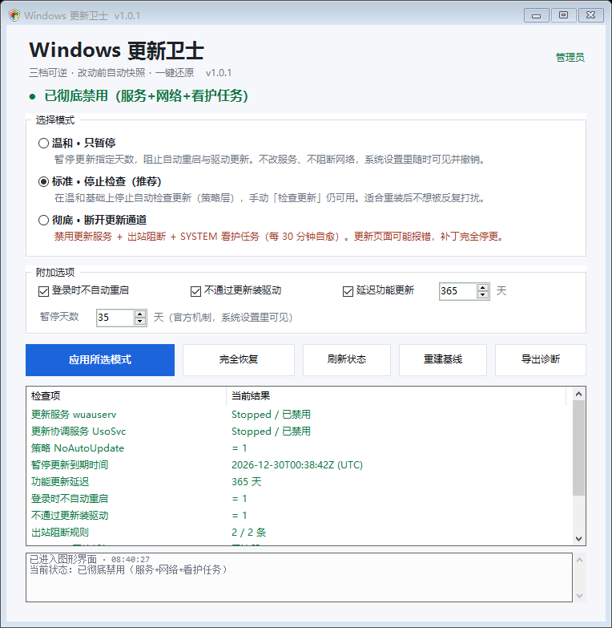

# Windows 更新卫士 · WinUpdateGuard

一个**三档可逆**的 Windows 更新管理工具，专为「重装系统后不想被更新反复打扰」设计。

免安装、免编译：单个 PowerShell 脚本 + 一个启动器，Windows 10/11 自带的 PowerShell 5.1 就能跑，放 U 盘里随时可用。



---

## 为什么不是"又一个一键禁更新"

网上流传的脚本大多是单向的：把服务改成禁用、伪造一个 9999 年的暂停日期，然后就没有然后了。等你想恢复更新，要么重装，要么手动去注册表里一行行翻。

这个工具的核心不是"禁得更狠"，而是**改之前先把原样记下来**：

- 首次应用前，把涉及到的每一项注册表值（包括「原本不存在」这件事）和两个服务的启动类型写进快照
- 恢复时逐项写回：原本有值的写回原值，原本没有的直接删掉
- 不会去动系统自带的 `WindowsUpdate` / `UpdateOrchestrator` 计划任务（很多工具在"恢复"时会把这些任务一股脑全启用，反而制造新问题）

---

## 快速开始

**直接下载**：<https://github.com/clq12/windows-update-guard/releases/latest> （不用 clone，解压即用）

1. 下载本仓库，解压到任意目录（U 盘、桌面都行）
2. 双击 **`启动.vbs`**，在弹出的 UAC 提示里选「是」
3. 选档位 → 点「应用所选模式」

> 如果 Windows 提示"已保护你的电脑"：右键压缩包 → 属性 → 勾选「解除锁定」→ 确定，再解压。
>
> 也可以直接跑脚本（需管理员 PowerShell）：
> ```powershell
> powershell -ExecutionPolicy Bypass -File .\WinUpdateGuard.ps1
> ```

---

## 三档到底改了什么

| 改动 | 温和 Lite | 标准 Standard | 彻底 Strict |
|---|:--:|:--:|:--:|
| 暂停更新（官方机制，设置页可见） | ✅ N 天 | ✅ N 天 | ✅ N 天 |
| 登录状态下不自动重启 | ✅ | ✅ | ✅ |
| 不通过 Windows 更新安装驱动 | ✅ | ✅ | ✅ |
| 延迟功能更新 N 天 | ✅ | ✅ | ✅ |
| `NoAutoUpdate=1`（停止自动检查） | — | ✅ | ✅ |
| `wuauserv` / `UsoSvc` 设为禁用并停止 | — | — | ✅ |
| 出站阻断规则 × 2（按服务） | — | — | ✅ |
| SYSTEM 看护任务（开机/登录/每 30 分钟自愈） | — | — | ✅ |

- **温和**：只暂停 + 两个附加策略，不动服务、不断网。到期后安全补丁照常装。适合"先安静一个月"。
- **标准**：在温和基础上关掉自动检查，手动点「检查更新」还能用。适合重装后的日常主力机。
- **彻底**：连服务一起停、断掉联网、加看护任务防系统自愈。适合离线测试机、老旧设备、或明确长期不更新。

三个档位是**递进**的，可以随时从温和升到彻底，也可以降回来（降档会自动拆掉多余的服务/防火墙/任务层）。

---

## 具体改了哪些注册表

| 位置 | 名称 | 作用 |
|---|---|---|
| `...\WindowsUpdate\AU` | `NoAutoUpdate` | 停止自动检查更新 |
| `...\WindowsUpdate\AU` | `NoAutoRebootWithLoggedOnUsers` | 有用户登录时不自动重启 |
| `...\WindowsUpdate` | `ExcludeWUDriversInQualityUpdate` | 质量更新不带驱动 |
| `...\WindowsUpdate` | `DeferFeatureUpdates` | 启用功能更新延迟 |
| `...\WindowsUpdate` | `DeferFeatureUpdatesPeriodInDays` | 延迟天数 |
| `...\WindowsUpdate\UX\Settings` | `PauseFeatureUpdatesStartTime` / `EndTime` | 功能更新暂停区间 |
| `...\WindowsUpdate\UX\Settings` | `PauseQualityUpdatesStartTime` / `EndTime` | 质量更新暂停区间 |
| `...\WindowsUpdate\UX\Settings` | `PauseUpdatesStartTime` / `PauseUpdatesExpiryTime` | 整体暂停区间 |

> 「暂停」走的是系统自己的机制，所以在 **设置 → Windows 更新** 里能看到"已暂停更新至 X 月 X 日"，也能手动点"继续更新"撤销。工具不会伪造 9999 年这种非法日期。

---

## 快照与回滚

首次应用时会在 `C:\ProgramData\WinUpdateGuard\snapshots\` 生成一份 `.ini` 快照：

```ini
[meta]
created=2026-11-25 08:07:57
mode=Lite
os=Microsoft Windows 10 专业版
taskexisted=0
[reg]
AU|NoAutoUpdate|DWord|1
AU|NoAutoRebootWithLoggedOnUsers|MISSING|
WU|ExcludeWUDriversInQualityUpdate|MISSING|
...
[svc]
wuauserv|3|0|Running
UsoSvc|2|1|Running
```

`MISSING` 表示"这一项原本不存在"，恢复时会把它删掉而不是写成 0。

点「完全恢复」会：
1. 删除本工具创建的看护任务
2. 删除两条 `WinUpdateGuard Block *` 防火墙规则
3. 按快照逐项写回注册表（有值的还原、没值的删除）
4. 按快照还原两个服务的启动类型（含"自动(延迟)"这个细节）
5. 尝试把 `wuauserv` 拉起来

**不会**启用系统自带的更新任务，**不会**碰你其它自定义策略。

> 找不到快照时会退化成"按 Windows 默认值恢复"（清空本工具涉及的所有策略值、服务回默认），并在日志里明确标注这是默认值而非原始状态。

---

## 命令行

适合批处理、装机脚本、无人值守：

```powershell
# 只看状态（不需要管理员）
.\WinUpdateGuard.ps1 -Status

# 应用彻底档
.\WinUpdateGuard.ps1 -Apply -Mode Strict -Yes

# 自定义天数
.\WinUpdateGuard.ps1 -Apply -Mode Standard -Yes -PauseDays 35 -DeferDays 365

# 应用但不改自动重启 / 不改驱动策略
.\WinUpdateGuard.ps1 -Apply -Mode Lite -Yes -NoAutoReboot -NoDriverExclude

# 完全恢复
.\WinUpdateGuard.ps1 -Restore -Yes

# 用指定快照恢复
.\WinUpdateGuard.ps1 -Restore -Yes -SnapshotPath "C:\ProgramData\WinUpdateGuard\snapshots\snapshot-20261125-080757.ini"
```

`-Apply` 必须带 `-Yes` 才会真正执行，避免误触。

---

## 手动急救

GUI 打不开、或者想彻底手动清理时：

```powershell
# 1. 删看护任务
Unregister-ScheduledTask -TaskName "WinUpdateGuard Keep" -Confirm:$false -ErrorAction SilentlyContinue

# 2. 删防火墙规则
netsh advfirewall firewall delete rule name="WinUpdateGuard Block wuauserv" dir=out
netsh advfirewall firewall delete rule name="WinUpdateGuard Block UsoSvc" dir=out

# 3. 服务回默认
sc.exe config wuauserv start= demand
sc.exe config UsoSvc start= delayed-auto

# 4. 清策略
Remove-ItemProperty "HKLM:\SOFTWARE\Policies\Microsoft\Windows\WindowsUpdate\AU" NoAutoUpdate -ErrorAction SilentlyContinue
Remove-ItemProperty "HKLM:\SOFTWARE\Policies\Microsoft\Windows\WindowsUpdate\AU" NoAutoRebootWithLoggedOnUsers -ErrorAction SilentlyContinue
Remove-ItemProperty "HKLM:\SOFTWARE\Policies\Microsoft\Windows\WindowsUpdate" ExcludeWUDriversInQualityUpdate -ErrorAction SilentlyContinue
Remove-ItemProperty "HKLM:\SOFTWARE\Policies\Microsoft\Windows\WindowsUpdate" DeferFeatureUpdates -ErrorAction SilentlyContinue
Remove-ItemProperty "HKLM:\SOFTWARE\Policies\Microsoft\Windows\WindowsUpdate" DeferFeatureUpdatesPeriodInDays -ErrorAction SilentlyContinue

# 5. 清暂停区间（6 个值）
$ux = "HKLM:\SOFTWARE\Microsoft\WindowsUpdate\UX\Settings"
"PauseFeatureUpdatesStartTime","PauseFeatureUpdatesEndTime","PauseQualityUpdatesStartTime","PauseQualityUpdatesEndTime","PauseUpdatesStartTime","PauseUpdatesExpiryTime" | ForEach-Object {
    Remove-ItemProperty $ux -Name $_ -ErrorAction SilentlyContinue
}

# 6. 起服务
sc.exe config wuauserv start= demand
Start-Service wuauserv
```

---

## 日志与诊断

- 操作日志：`C:\ProgramData\WinUpdateGuard\logs\guard-YYYYMMDD.log`
- 界面右下角实时显示每一步
- 「导出诊断」会在桌面生成一份报告（状态清单 + 快照内容 + 最近 60 行日志），方便排查或提 issue

---

## 已知限制

1. **不保证永久有效**。系统大版本升级、WaaSMedic 修复服务、域策略都可能把设置改回去——彻底档的看护任务就是为这个准备的，但它也不是万能的。
2. **彻底档会停掉安全补丁**，同时影响 Microsoft Store 应用更新、驱动更新、部分 Defender 平台更新。请自己权衡。
3. Windows 11 某些版本会忽略 `NoAutoUpdate`，所以标准档在部分机器上效果有限，需要彻底档。
4. 「暂停」有系统上限，写太长（>35 天）可能被系统自动改回 35 天。建议按 35 天用，到期再点一次。
5. 「恢复」只针对本工具改过的项，**不会**清理你之前用其它工具留下的设置。
6. 没有数字签名，可能触发 SmartScreen 或杀软提示（脚本类工具的正常现象）。介意的话可以直接读源码，全部逻辑在一个 `.ps1` 文件里。
7. 家庭版没有组策略编辑器，但 `HKLM\SOFTWARE\Policies` 下的策略依然生效。

---

## 与旧版 `WindowsUpdateManager v0.1` 的差别

| | 旧版 v0.1 | 本工具 |
|---|---|---|
| 形态 | C# exe + 内嵌 ps1（Base64 传给 PowerShell） | 纯 ps1 + vbs 启动器，逻辑全透明 |
| 档位 | 只有"禁用/恢复" | 三档，可升可降 |
| 改动前备份 | 无 | 完整快照（含"原本不存在"） |
| 恢复行为 | 无条件删策略 + 启用全部系统更新任务 | 按快照精确还原，绝不碰系统任务 |
| 状态校验 | 只看服务启动类型 | 11 项分项检查，逐条列出 |
| 日志 | 有 | 有，并支持一键导出诊断包 |
| 迁移/重装 | 需重新下载 | 一个文件夹拷走即可 |

---

## 目录结构

```
Windows更新卫士/
├─ 启动.vbs                 # 双击入口（提权 + 无黑窗）
├─ WinUpdateGuard.ps1       # 全部逻辑（GUI + CLI）
├─ README.md
├─ LICENSE
└─ docs/
   └─ ui-preview.png
```

---

## 许可

MIT，随便改、随便分发。改完建议在说明里写清改了什么，方便别人判断。
